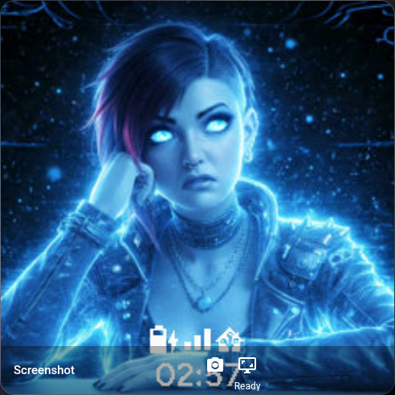

# ESPHome Screenshot

`esp_screenshot` takes an image on request and serves the last successful JPEG.
It is an optional ESPHome component. It works independently of VoIP Stack and
requires ESP-IDF and network connectivity. The default memory placement requires
PSRAM; internal placement can be chosen explicitly for sufficiently small captures.
Build with ESPHome 2026.10.0 or newer and Python 3.12 or newer.
The LVGL backend uses official ESPHome display/LVGL components. Home Assistant,
VoIP Stack, Audio Stack and Intercom are not required for LVGL capture or HTTP
image access. The optional P4 framebuffer provider is described separately below.

## Choose the capture backend

| Backend | Configuration | Captured content |
| --- | --- | --- |
| P4 MIPI DSI framebuffer | `mipi_dsi_id` | Completed display pixels, including video drawn directly to the display |
| LVGL composed refresh | `lvgl_id` | All LVGL layers sent during a complete refresh |

Choose exactly one backend. The P4 backend uses the maintained Intercom
`mipi_dsi` provider because official ESPHome does not expose the synchronized
framebuffer copy API. The adaptation is compiled only when screenshots are
included. The copy takes the same mutex as panel DMA submissions and returns
busy immediately when a transfer owns the framebuffer. It exports RGB565 in
the display driver's logical orientation, including its rotation and byte order
conversion. An optional `rotation` applies an additional clockwise rotation to
the screenshot only, with values `0` (default), `90`, `180` or `270`.
RGB888 framebuffer capture is currently unsupported. This backend reads the
driver framebuffer, rather than the physical panel controller.

The synchronized provider contract is the public method
`mipi_dsi::MipiDsi::copy_frame_buffer_rgb565(uint8_t *, size_t, display::DisplayRotation)`.
It remains in Intercom's `mipi_dsi` driver, guarded by `USE_ESP_SCREENSHOT`; this
repository neither copies nor refactors that driver. Upstream ESPHome's driver
without that method cannot link the `mipi_dsi_id` backend. The optional example
[examples/p4-mipi-dsi.yaml](examples/p4-mipi-dsi.yaml) selects that provider explicitly.

The LVGL backend uses public display events without replacing the display's
flush callback or forking its driver. It captures a complete refresh, including
the top and system layers. It supports RGB565 partial rendering without display
offsets. It checks pixel coverage before encoding: missing rectangles fail the
capture rather than producing an image containing stale pixels. A paused LVGL
display must be resumed before capture. Its image represents the pixels
submitted through LVGL; investigate display-driver errors separately when
checking whether the physical panel received every transfer.

Use the framebuffer backend when anything draws outside LVGL. The LVGL backend
cannot capture independent direct-to-panel video or another writer's pixels.
Some SPI displays keep their only complete framebuffer inside the panel itself;
the component does not claim readback support for those panels.

LVGL's software rotation is independent of the display driver's rotation. A
portrait MIPI framebuffer can therefore contain a landscape GUI sideways even
when the display driver reports rotation `0`. For example, the maintained P4
FULL landscape UI uses `lvgl.rotation: 270` on an 800x1280 native framebuffer;
set screenshot `rotation: 90` to obtain an upright 1280x800 JPEG from that MIPI
backend. This does not change the panel, touch, video or LVGL configuration.
The LVGL capture backend already follows LVGL's logical coordinates and rejects
an additional nonzero screenshot rotation.

## Add to an existing firmware

For an S3 display fully owned by LVGL:

```yaml
external_components:
  - source:
      type: git
      url: https://github.com/n-IA-hane/esphome-screenshot
      ref: dev
      path: esphome/components
    components: [esp_screenshot]

esp_screenshot:
  id: screen_capture
  lvgl_id: lvgl_ui  # ID of your existing LVGL component
  path: screen
  quality: 85
  max_jpeg_size: 65536  # Bytes per JPEG slot; increase if encoding overflows
  capture_id:
    name: Screenshot ID
  capture_status:
    name: Screenshot status

button:
  - platform: template
    name: Take screenshot
    icon: mdi:monitor-screenshot
    entity_category: diagnostic
    on_press:
      - esp_screenshot.capture:
          id: screen_capture
```

For P4, select the maintained MIPI DSI display instead:

```yaml
external_components:
  - source:
      type: git
      url: https://github.com/n-IA-hane/esphome-screenshot
      ref: dev
      path: esphome/components
    components: [esp_screenshot]
  - source:
      type: git
      url: https://github.com/n-IA-hane/esphome-intercom
      ref: dev
      path: esphome/components
    components: [mipi_dsi]

esp_screenshot:
  id: screen_capture
  mipi_dsi_id: main_display  # ID of your existing RGB565 MIPI DSI display
  rotation: 0  # Additional clockwise image rotation; use 90 for P4 FULL landscape
  path: screen
  quality: 85
  max_jpeg_size: 262144
  capture_id:
    name: Screenshot ID
  capture_status:
    name: Screenshot status
```

Keep the same `button` block from the S3 example. Alternatively, include
`packages/screenshot.yaml`, which exposes **Take screenshot** and
the existing `take_screenshot` native API action for the component ID
`screen_capture`. The package accepts `screenshot_id` when the component uses
a different ID. Configure the capture backend, `capture_id` and
`capture_status` on `esp_screenshot` in the main YAML.

A local button or another automation can call `esp_screenshot.capture` directly.
The action requests capture and returns immediately. **The Screenshot ID changes
only after a JPEG is successfully published.** A busy or failed capture preserves
the preceding image and its identifier. The optional Screenshot status sensor
shows `No screenshot` after startup, `Capturing`, `Ready`, `Busy` or `Error:`
followed by the failure reason. Errors are also reported in the ESPHome log.

## Optional Home Assistant, capture and view with one click

The **Take screenshot** button and the two sensors appear through the existing
ESPHome integration. Use Home Assistant's built-in **Template Image** helper
to display the JPEG. This works with both backends and leaves the device's
camera available for its normal purpose. No custom Home Assistant integration
or separate image server is required.

1. Open **Settings > Devices & services > Helpers > Create helper > Template >
   Image**. Name it **Screen screenshot** and optionally attach it to the
   existing ESPHome device.
2. Set its **URL** to the following template, replacing the host and sensor
   with your device's values:

   ```jinja
   http://screen.local/esp_screenshot/screen/image.jpg?capture={{ states('sensor.screen_screenshot_id') }}
   ```

3. Under **Additional options**, set **Availability** to:

   ```jinja
   {{ has_value('sensor.screen_screenshot_id') and states('sensor.screen_screenshot_id') != '' }}
   ```

   The helper can be created before taking the first screenshot. Until a JPEG
   exists, it is unavailable and Screenshot status shows `No screenshot`.
4. Add this standard **Picture Glance** card, selecting your actual image,
   button and status entity IDs:

   ```yaml
   type: picture-glance
   title: Screenshot
   image_entity: image.screen_screenshot
   fit_mode: contain
   entities:
     - entity: button.screen_take_screenshot
       icon: mdi:camera
       show_state: false
       tap_action:
         action: perform-action
         perform_action: button.press
         target:
           entity_id: button.screen_take_screenshot
     - entity: sensor.screen_screenshot_status
       show_state: true
   ```

Press the camera icon to take and display a fresh screenshot. The successful
capture changes Screenshot ID, which changes the helper's URL and invalidates
its cached image. The card updates from the image entity's state change.
Repeated reads use the cached JPEG; they do not request another capture. A failed
capture keeps the last successful image visible and shows its error in the
status sensor. After a device restart, take a new screenshot to populate the
device's empty image store.



_The actual Home Assistant card after pressing the native ESPHome screenshot
button. This JPEG came from a physical S3 device through the LVGL capture
backend, using the public `f_off` assistant artwork. Template Image and Picture
Glance are built-in Home Assistant features; `Ready` is the device's capture
status._

For YAML-managed helpers, the equivalent configuration is:

```yaml
template:
  - image:
      - name: Screen screenshot
        unique_id: screen_screenshot
        availability: >-
          {{ has_value('sensor.screen_screenshot_id') and states('sensor.screen_screenshot_id') != '' }}
        url: >-
          http://screen.local/esp_screenshot/screen/image.jpg?capture={{ states('sensor.screen_screenshot_id') }}
```

The image is fetched by Home Assistant and served to the dashboard through its
image proxy. There is no periodic image capture or image-fetch polling. Use the
image entity directly in the card, as above, so Home Assistant adds its image
state to the browser URL for cache invalidation.

### Authenticated HTTP endpoint

If web server authentication is configured, the screenshot endpoint inherits
it. Template Image has no dedicated HTTP authentication fields. Use the built-in
**Generic Camera** integration for an authenticated endpoint:

1. Press **Take screenshot** once before adding Generic Camera, because its
   setup validates the JPEG.
2. Use the same templated URL above as **Still Image URL**. Leave **Stream
   Source** empty and enter the endpoint's **Username** and **Password** in
   their dedicated fields. Select the matching **Authentication** type under
   advanced options.
3. Enable **Limit refetch to URL change** in the integration's options after
   setup. Use its `camera` entity in a standard picture card alongside the
   same capture button and status sensor.

Generic Camera displays a changed JPEG on the frontend's next image request.
It does not trigger captures. Keep the endpoint's authentication enabled and
keep credentials out of URLs and dashboard configuration.

An explicit expired `capture` identifier receives HTTP 410 instead of a different
image under an old URL. Before the first successful capture the endpoint returns
HTTP 503.

## Resource ownership

The component preallocates one RGB565 snapshot, two bounded JPEG slots and a
persistent worker during setup. The software encoder runs in mono-task mode;
it does not use P4's hardware JPEG peripheral, so screenshot compression does
not take the video codec peripheral away from a call.

The raw snapshot is immutable during encoding. HTTP readers lease a published
JPEG slot until the synchronous response finishes. A later capture cannot
reuse a slot that a reader still owns. When both slots are occupied, another
capture returns busy instead of allocating more memory.

Approximate image payload storage is:

```text
width * height * 2 + 2 * max_jpeg_size bytes
```

LVGL capture additionally uses one coverage bit per pixel. The worker reserves
6144 bytes of PSRAM stack and retains its task control block in internal memory,
in addition to encoder state. PSRAM stacks use IDF's static-task API and must stay
out of cache-disabled routines. Example: a 360x360 screen with two 65536-byte
JPEG slots reserves 390272 bytes for image payloads,
plus 16200 bytes for LVGL coverage. Actual heap use includes the codec and RTOS
objects. JPEG size depends on content; an image exceeding `max_jpeg_size` fails
without replacing the last valid screenshot.

Capture and encoding are on demand. There is no periodic capture task, no
continuous framebuffer mirror and no encoder task created per request. The
LVGL backend requests a full refresh and copies its rectangles in the main
loop; this can briefly delay UI work. Exclude that requested-capture window
from continuous timing baselines. JPEG compression runs in the worker.

MIPI image rotation is part of the existing synchronized RGB565 copy. It uses
the same snapshot buffer and one pixel pass; 90 and 270 degrees swap the JPEG
width and height. It does not enable the encoder's rotation option, which does
not support this RGB565 input format.

## Optional execution and memory tuning

The defaults request no core affinity and priority 1. The 6144-byte stack and
component-owned image buffers use PSRAM; the task control block stays in
internal memory. Include overrides only when tuning a measured workload:

```yaml
esp_screenshot:
  id: screen_capture
  lvgl_id: lvgl_ui
  task_core: any           # any, 0 or 1
  task_priority: 1         # FreeRTOS priority, 1 through 24
  task_stack_size: 6144    # Bytes, 4096 through 65536, multiple of 16
  task_stack_in_psram: true
  buffer_in_psram: true
```

`task_core: any` requests `tskNO_AFFINITY`; FreeRTOS can apply its normal FPU
affinity policy. A numeric value requests that core explicitly.

`buffer_in_psram` controls the raw snapshot, JPEG slots and LVGL coverage map.
It does not change allocations private to the vendor codec. Memory allocation
uses the requested capability explicitly: an unavailable block fails setup
with an error, rather than silently consuming another memory pool. Choosing
internal image buffers can exhaust the memory needed by audio and display DMA.
`dump_state()` prints an on-demand diagnostic with free and largest blocks for
internal/DMA memory and free PSRAM, together with the configured worker
affinity, priority, stack placement and minimum free stack bytes.

## Local development and complete LVGL example

Version: `2026.11.1-dev`. The four component implementation files were extracted
without byte changes from Intercom commit `03436d6e433c6a4306f095fe4f1b01de389f0c2e`.
The original MIT license and [source hashes](SOURCE.md) are preserved. No Home Assistant Python package is needed
to develop or use this component.

[examples/lvgl-s3.yaml](examples/lvgl-s3.yaml) is a complete compile-only S3 example
with an official GC9A01A SPI display, LVGL, Wi-Fi and the native screenshot package.
Replace its display pins, model, PSRAM settings and Wi-Fi values for your hardware.
Its `local` source resolves `../esphome/components` from the example file, so it
works from a checkout without fetching Intercom.

For an existing local firmware the component source is:

```yaml
external_components:
  - source:
      type: local
      path: /path/to/esphome-screenshot/esphome/components
    components: [esp_screenshot]
```

The optional generic package can be included from the same checkout:

```yaml
packages:
  screenshot: !include
    file: /path/to/esphome-screenshot/packages/screenshot.yaml
    vars:
      screenshot_id: screen_capture
```

This package adds one template button and one native API action. It does not
implement a second capture engine and is optional for firmware without the API.
An ordinary automation can call `esp_screenshot.capture` directly instead.

For a remote checkout, use the Git source with `path: esphome/components` shown
above. `main` is the default branch and `dev` is the development branch.
Both initially contain `2026.11.1-dev`; no stable release is tagged yet.
Pin an appropriate reviewed ref for your deployment. The native package also
supports the standard remote package include:

```yaml
packages:
  screenshot: github://n-IA-hane/esphome-screenshot/packages/screenshot.yaml@dev
```

The configured endpoint can be opened directly in a browser after capture:
`http://screen.local/esp_screenshot/screen/image.jpg`. No Home Assistant dashboard
or media service is required. The optional API package uses ESPHome's API; its
normal client requirements apply. Configure API encryption when using that API.

Install development dependencies and run the existing host contracts:

```bash
python -m pip install -r requirements-dev.txt
python -m pytest -q
python -m ruff check .
python -m esphome config examples/lvgl-s3.yaml
python -m esphome compile examples/lvgl-s3.yaml
```

The CI workflow runs host/schema checks and one actual ESP32-S3 SDK smoke build,
with two compiler jobs and lower process priority. It does not flash hardware or
qualify screenshots, acoustic behavior or panel DMA on a physical device.

## Verification

The standalone tests exercise immutable HTTP-reader leases, failed-publication
recovery, overlapping/incomplete LVGL rectangles, resource placement and capture
status. Configuration/code-generation tests cover LVGL and P4 rotation settings.
The P4 synchronized driver-copy tests remain with the Intercom provider. A single
ESP32-S3 LVGL SDK smoke build checks real compilation and dependency integration.
P4 schema/code-generation success is not a P4 SDK link or physical-panel test.
These checks do not substitute for physical screenshots on the intended device.

References: [ESPHome template button](https://esphome.io/components/button/template/),
[Home Assistant Template Image](https://www.home-assistant.io/integrations/template/#image),
[Home Assistant Picture Glance](https://www.home-assistant.io/dashboards/picture-glance/),
[Home Assistant Generic Camera](https://www.home-assistant.io/integrations/generic/),
[Espressif software JPEG codec](https://components.espressif.com/components/espressif/esp_new_jpeg/versions/1.0.2/readme).
